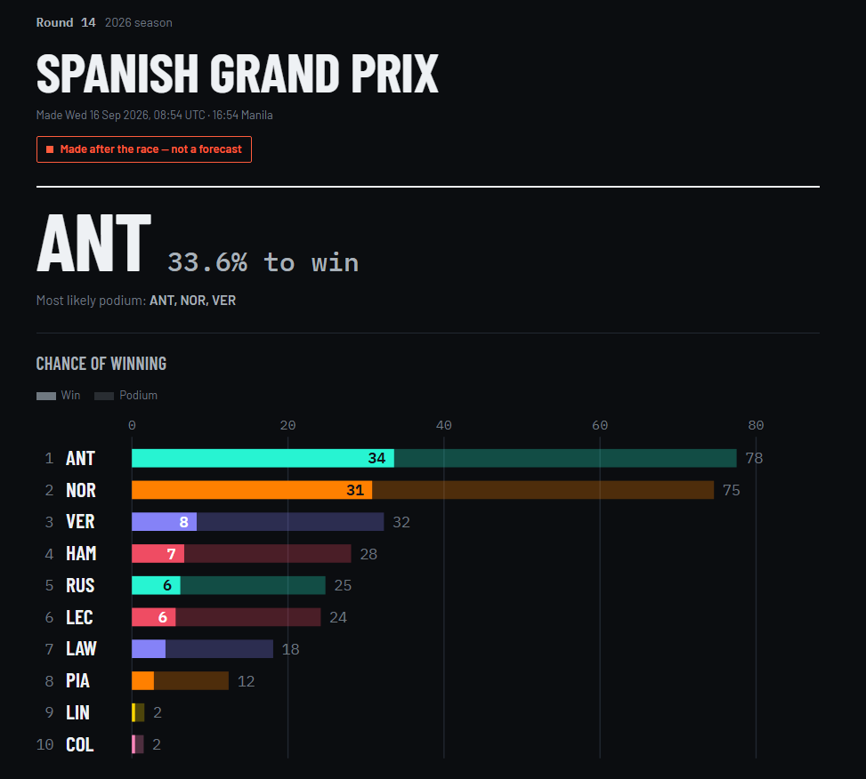
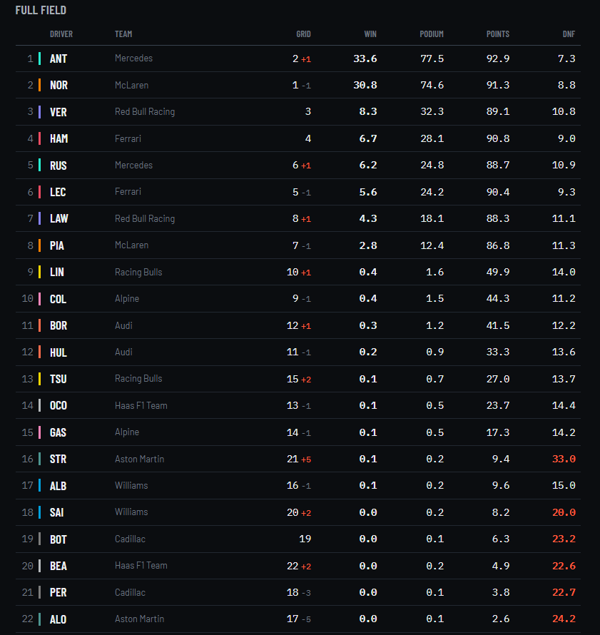

# f1-prediction

Published as **P(1)**, the odds behind P1: https://rdgonzaga.github.io/f1-prediction/

Predicts an F1 race once qualifying is done: the finishing order, plus each driver's chance of
winning, reaching the podium, scoring points, or retiring. Saves it as a web page you can open on
your phone or send to someone.





## What it's actually good at

Straight answer: it doesn't predict the finishing order any better than assuming everyone finishes
where they started. That was tested properly, across 48 races in the 2024 and 2025 seasons, model
against grid, race by race. Everything landed inside the margin of error, and a couple of variants
came out worse.

The percentages are the real output, and a starting grid can't give you those. The grid tells you
Norris starts first. It can't tell you he's 31% to win, or that Stroll has a 33% chance of not
finishing. Those numbers hold up against races that already happened: across 2025 the eventual
winner scored 1.04 on log loss, against 2.99 for treating every driver as equally likely.

The retirement estimate is the weak one. Over 2025 it scores exactly the same as just using the
field's recent failure rate (0.090 Brier each), so no better. It only pulls ahead in 2026 (0.144
against 0.155), when reliability shifted and a per-driver estimate started to matter.

So read the order as "the grid, give or take", and pay attention to the numbers next to it.

Real predictions, made after qualifying and scored after the race, start at Baku 2026. The running
tally is in `data/processed/predictions/scorecard.csv`.

## A race weekend

The short version: double-click `next.bat`, or run `python -m f1pred next`. It looks at the
schedule and does whatever's due: predicts after qualifying, predicts again once the official
grid is out, and scores after the race. If nothing's due it tells you the next session. Add
`--publish` to commit and push `site/` too (only on `main`). `--penalty`, `--pitlane` and `--grid`
work the same as on `predict`; given after the race is already predicted, they predict it again.

To skip the clicking, `scripts/schedule-next.ps1` sets up a Windows task that runs
`next --publish --notify` hourly from Saturday 12:00 to Monday 18:00 Manila time (that covers every quali and every result, including races in the Americas that end on Monday), logging to `data/next.log`. `--notify`
pops a Windows toast when a step finishes or fails. Outside a race weekend it just exits. `scripts/schedule-next.ps1 -Remove` takes it off again.

`--publish` also mirrors `data/raw` and the saved predictions to an orphan `data` branch, and
copies in any files there that are missing locally (it never overwrites). The `Next` workflow
uses that branch to run `next --publish` every 3 hours on GitHub, so a race still gets
predicted and scored when the PC is off.

The rest of this section is what it runs under the hood.

Run it after qualifying and before the race, since qualifying is what it works from. Timing data
takes a few minutes to land, so give it about 90 minutes after the session starts.

```
python -m f1pred weekend 2026 16
```

That fetches the new sessions, rebuilds, predicts and saves everything for the race in
`data/processed/predictions/2026/round_16/`. Open the `.html` in any browser, or send the `.png`, a
full-page picture made with your installed Edge or Chrome. If qualifying isn't out yet it stops and
says so; add `--wait 60` to keep retrying every 5 minutes for up to an hour.

The same thing as separate steps, e.g. to re-run just the prediction after adding a penalty:

```
python -m f1pred fetch --seasons 2026 --rounds 16
python -m f1pred build
python -m f1pred predict 2026 16 --no-refresh
python -m f1pred report 2026 16
```

Use the round number rather than the race name. A number is used as-is, while a name gets
fuzzy-matched and can quietly land on the wrong event.

Once the race is over, `python -m f1pred score --refresh` tells you how it did and updates
`scorecard.csv`. Run `python -m f1pred market 2026` before it to save Polymarket's winner odds from
an hour before the start; `score` then puts the market's winner log loss next to ours, and the
site shows both on each race page and the scorecard. Prices stay
up after the race, so it can catch up on any round you missed.

**The starting grid is fetched for you.** Penalties never appear in the timing data (Antonelli's
12-place drop at Monza isn't in any qualifying message), so `predict` pulls the official starting
grid from formula1.com, with OpenF1 as a backup. The race page says which one it used. If neither
has published it yet, the model assumes everyone starts where they qualified and the page says the
grid is provisional.

You can still set it by hand, which skips the fetch:

```
python -m f1pred weekend 2026 16 --penalty VER=5 --pitlane STR
```

Prefer the exact slot when you know it: `--grid RUS=19`. "Back of the grid" depends on who else got
penalised, so at Singapore 2026 `--penalty RUS=30` put Russell 22nd when he actually started 19th.

**Run it before the race starts.** Once the result exists, `predict` refuses, since a prediction made
in hindsight doesn't count when you score it. `--backfill` saves one anyway.

## The website

Every prediction is up at https://rdgonzaga.github.io/f1-prediction/. The latest race leads with its
predicted podium and, once the race is done, how it went. There's also an archive of every race, a
page per driver, the season scorecard and a plain-language explainer. `weekend` and `score` both rebuild `site/` when they finish, so after a
race it's just:

```
python -m f1pred score --refresh
```

Then commit `site/` and push. `python -m f1pred site` rebuilds it on its own if you need to. GitHub deploys it about a minute later. The predictions themselves are
still made on your machine, since they need the downloaded timing data and any penalties you entered.

## The other commands

`fetch` on its own downloads every season from 2022 to now. It's resumable, skips what it already
has, and ignores sessions that haven't happened yet. FastF1 allows 500 calls an hour so a full
download takes a few hours, but week to week it only grabs the new sessions.

`build` combines the downloads and runs sanity checks. `backtest` replays past races, which is the
only honest way to tell whether a change helped. Add `--probabilities` to score the percentages
too, and judge changes on those (winner log loss, podium and points Brier) over the full 2024 and
2025 seasons. Beating grid order by a hair on 2026 alone is noise.

`season 2026` builds one page for the whole season: model against grid order race by race, and
whether the podium percentages came true about as often as they said. Live predictions are marked;
the rest were made after the race, using only the races before them.

## How it works

Practice, qualifying, sprint and race sessions from 2022 on. Telemetry is never loaded, since it was
97% of the storage and lap times already carry the pace.

The model mostly looks at the grid and qualifying: grid slot, pit-lane start, qualifying position,
gap to pole, gap to teammate. On top of that it gets one pace estimate: where the driver ranks on
practice lap time, recent finishes and the team's recent qualifying, and how far behind that they're
starting. That's for the fast car stuck at the back, like Antonelli going from 19th on the grid to a
win at Monza. It also knows the track: how well grid order has held there before and how often it
brings out a safety car, so starting 16th in Baku counts for less than starting 16th in Monaco. Both
improved the 2024 and 2025 backtests but not the (shorter) 2026 one.

Raw practice pace, recent form, career record and track history are all built and available, just
switched off, because on their own they made things worse. With about 100 races to learn from, the
model memorises those features instead of learning from them.

Underneath it's an `XGBRanker` in pairwise mode, so it learns to order drivers within a race rather
than guess each position on its own. The percentages come from simulating each race 20,000 times
from those scores, with the spread tuned on how the top three actually finished recently. A separate
model estimates each driver's chance of retiring and drops them to the back.

Every measurement is walk-forward, so predicting a race only ever uses races that happened before
it. Tests in `tests/test_features.py` guard against leaking future information.

## Upkeep

Each new season, add a row per team to `reference/power_units.csv`. `build` warns if one is missing.
When the regulations change (next expected 2031), add that year to `ERA_STARTS` in
`src/f1pred/config.py`, since races from the same era get 3x training weight when the pecking order
resets.

The retirement model gives races from the current era 10x weight, because reliability resets with new
cars. Without that it predicted about 14% retirements in 2026 against a real 18%; with it, 17%.

## Setup

```
python -m venv .venv
.venv\Scripts\activate
pip install -r requirements.txt
pip install -e .
pytest
```

The notebooks need Jupyter on top: `pip install -r requirements-dev.txt`, then pick the `.venv`
kernel.

## Layout

```
src/f1pred/   fetch, build, features, model, evaluate, probabilities, dnf, predict, report,
              score, market, season, weekend, plotting
  web/        the website: page data, SVG charts, Jinja templates and CSS
tests/        one test file per module, plus leakage checks in test_features.py
notebooks/    exploration and review only
reference/    power_units.csv, engine supplier per team per season
```
